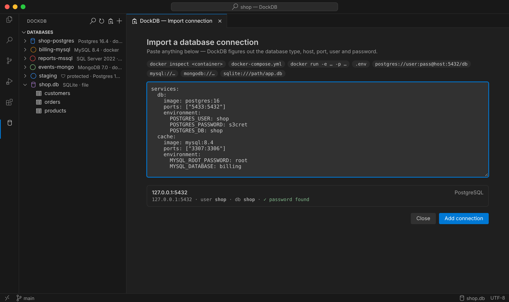
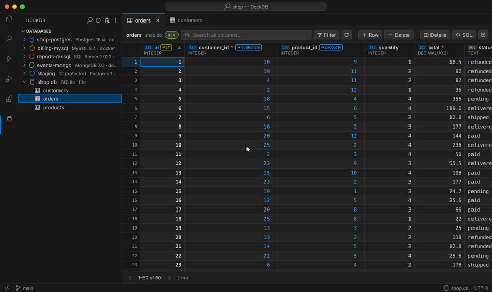
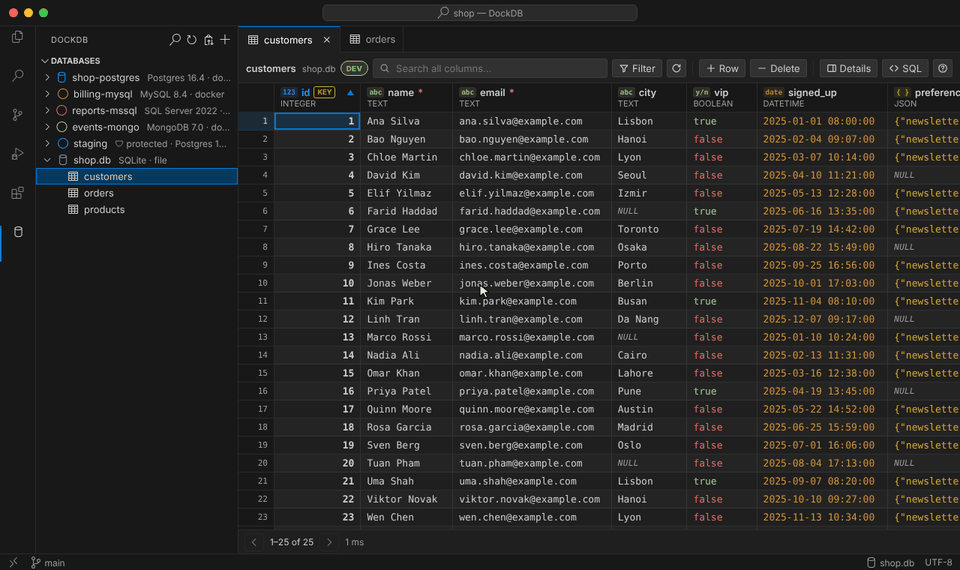
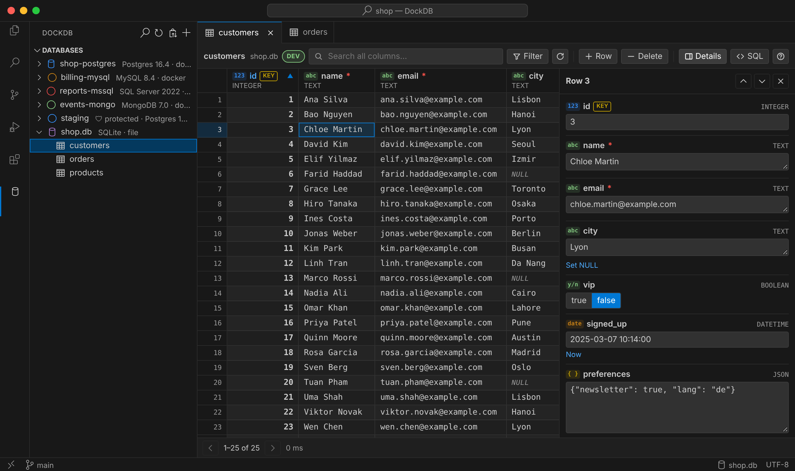
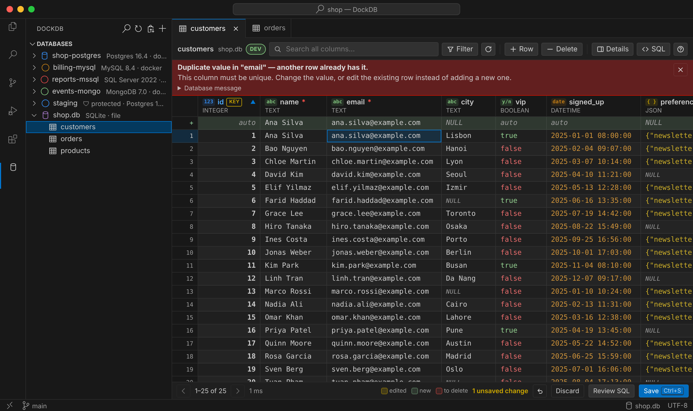
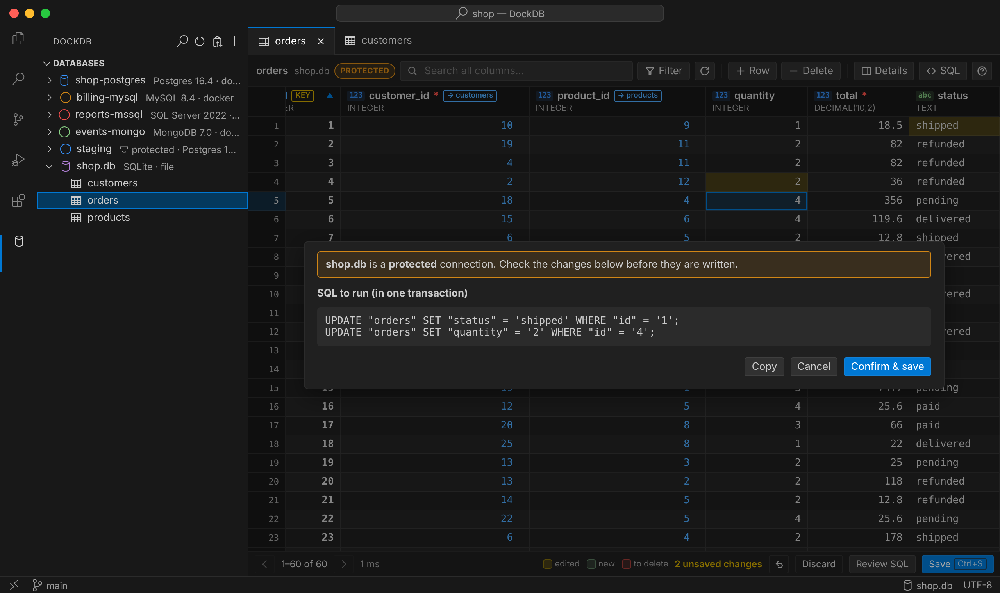
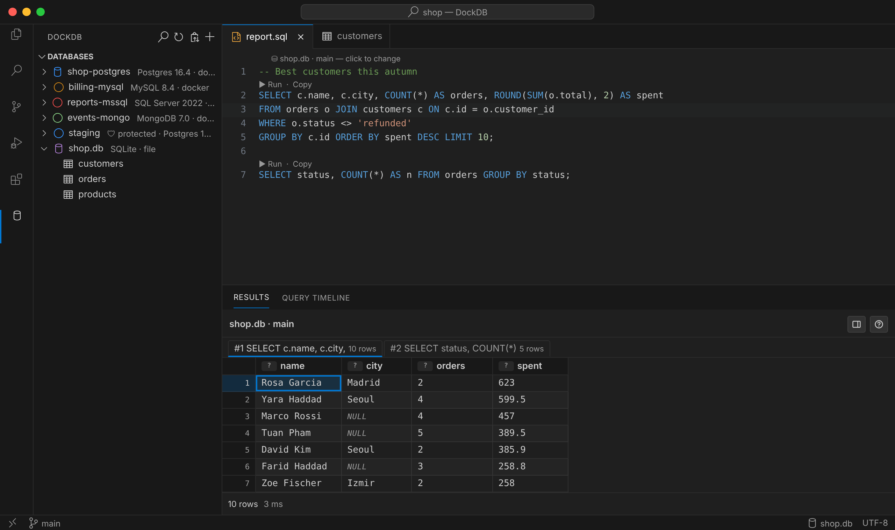
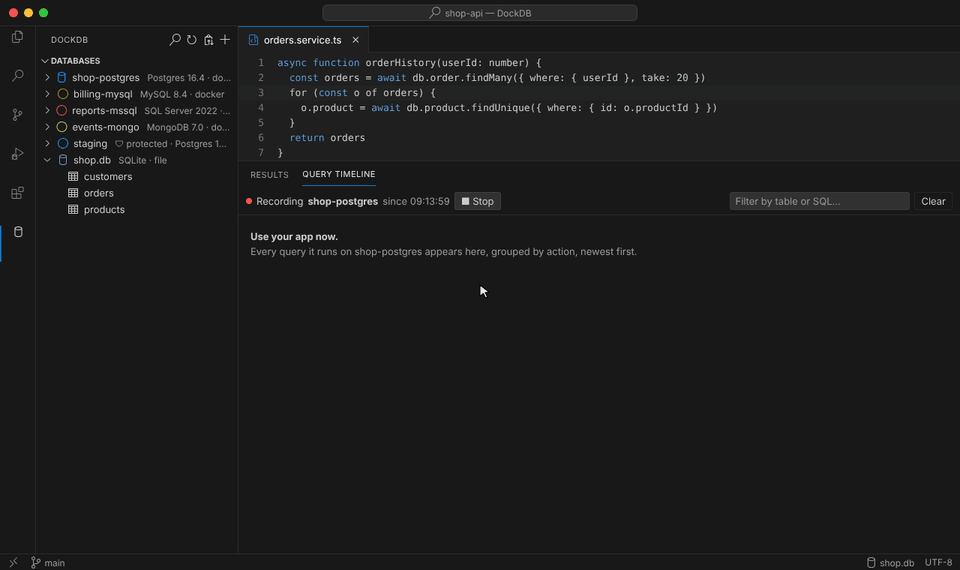

# DockDB

Browse and edit databases inside VS Code with almost zero setup. Open the sidebar and the databases running in Docker are already there; click a table and you get an editable, DataGrip-style grid.

Built for people who work *with* databases but are not database specialists — every column tells you what it holds, errors come back in plain language, and nothing is written until you press Save.


## Supported databases

| Database | Auto-detected from | Browse / search / filter | Edit / add / delete rows | Query editor |
| --- | --- | --- | --- | --- |
| PostgreSQL (postgres, postgis, timescale, pgvector, supabase…) | Docker, ports | ✓ | ✓ (tables without a primary key use `ctid`) | SQL |
| MySQL / MariaDB / Percona | Docker, ports | ✓ | ✓ (tables without a primary key match every column + `LIMIT 1`) | SQL |
| Microsoft SQL Server (`mssql/server`, Azure SQL Edge) | Docker, ports | ✓ | ✓ (tables without a primary key match every column + `TOP (1)`) | SQL |
| SQLite | `*.db`, `*.sqlite` files in the workspace | ✓ | ✓ (tables without a primary key use `rowid`) | SQL |
| MongoDB (mongo, bitnami, percona, Atlas via `mongodb+srv://`) | Docker, ports | ✓ (collections shown as tables) | ✓ (by `_id`, BSON types preserved) | mongo shell syntax |

## Finding your databases — nothing to configure

When the **DockDB** sidebar opens, it scans in parallel:

1. **Docker** — `docker ps` + `docker inspect`, then reads credentials from the env vars that official images use (`POSTGRES_USER/PASSWORD/DB`, `MYSQL_ROOT_PASSWORD`, `MARIADB_*`, `MSSQL_SA_PASSWORD`, `MONGO_INITDB_ROOT_USERNAME/PASSWORD`, bitnami `POSTGRESQL_*`/`MONGODB_*`…). App containers that merely *connect* to a database (a backend with `POSTGRES_HOST`…) and DB admin UIs (mongo-express, adminer…) are not mistaken for databases.
2. **Local ports** — every listening port is probed: MySQL sends a greeting, Postgres answers an SSLRequest, MongoDB answers `hello`, SQL Server answers a TDS PRELOGIN request. Databases on unusual ports are found too.
3. **SQLite** — files starting with the `SQLite format 3` header.

Opening a detected database saves it. If the login fails, DockDB asks once and keeps the password in the VS Code keychain (SecretStorage).

Can't be detected? Use **Paste docker inspect / compose / URL** (📋). It accepts `docker inspect` output, a `docker-compose.yml` snippet, a `docker run -e … -p …` command, a `.env` file, or a URL (`postgres://`, `mysql://`, `sqlserver://`, `mongodb://`, `mongodb+srv://`, `jdbc:…`, `sqlite:///path`). If your clipboard already holds one of those, it is pre-filled. (SQL Server's semicolon-style JDBC/ADO.NET connection strings aren't parsed yet — add those connections manually.)



## The grid

### Reading a table

Every column header shows:

| Badge | Meaning |
| --- | --- |
| `abc` `123` `date` `y/n` `{ }` `id` | Text, number, date/time, true/false, JSON/nested data, generated ID |
| `*` | Required — you must fill it in when adding a row |
| `KEY` | Primary key — uniquely identifies each row |
| `→ users` | Foreign key — the value points to a row in `users`. Click ↗ in the cell to open that row |

Hover a header for a plain-language explanation. `NULL` (grey, italic) means *no value*, which is different from empty text.

### Finding rows — no SQL needed

- **Search** looks for text in every column (case-insensitive).
- Right-click a cell → **Filter by value** / **Exclude value**.
- A column's **▾** menu (or right-click the header): sort, *equals…*, *contains…*, *greater/less than…*, *is empty*, *is not empty*.
- Want the real thing? **Filter** opens a bar that accepts a SQL `WHERE` condition, or a MongoDB filter like `{ age: { $gt: 18 } }`. Filters built from the menus show up there too, so you can learn the syntax as you go.



### Editing

| Action | How |
| --- | --- |
| Edit a cell | Double-click, `Enter`, `F2`, or just start typing (IMEs such as Vietnamese Telex/VNI work) |
| Line break in a cell | `Alt+Enter` |
| Set to NULL | `Delete` / `Backspace`, or **Set NULL** in Details |
| Add / duplicate a row | **+ Row**, or right-click |
| Delete rows | `⌘⌫` / `Ctrl+Backspace`, or **− Delete** |
| Undo | `⌘Z` |
| Save | `⌘S` — everything runs in **one transaction** |
| Copy / paste | `⌘C` / `⌘V` as TSV — works with Excel and Google Sheets; pasting past the last row adds rows |
| Copy as CSV / JSON | Right-click |
| Resize a column | Drag the header edge |



**Details** (toolbar) shows the selected row as a form: true/false toggles, a **Now** button for dates, **Format JSON** for JSON columns, and a link to open the row a foreign key points to. Handy for wide tables. The **?** button explains all of this inside the grid.



### Saving safely

- Until you press Save, changes are only local: yellow = edited, green = new, red = to delete. **Discard** throws them away.
- Before saving, DockDB checks required columns, numbers and JSON, and outlines problem cells in red.
- Deleting always shows the statements that will run and asks for confirmation. **Review SQL** shows them at any time.
- Every `UPDATE`/`DELETE` must hit exactly one row; if someone changed the data meanwhile, everything is rolled back.
- Database errors are translated: *“Duplicate value in "email": a@x — another row already has it”* instead of `23505 duplicate key value violates unique constraint`. The original message is one click away.



## Safety modes

Each connection has a safety mode — shown in the sidebar, the grid toolbar and the status bar of query files. Right-click a connection → **Set Safety Mode…**, or click the badge in the grid.

| Mode | What happens | Default for |
| --- | --- | --- |
| 🟢 **Dev** | Edit freely. Only deleting rows asks for confirmation. | localhost, Docker containers, SQLite files |
| 🟠 **Protected** | Every grid save shows the statements and asks *Confirm & save*; write queries in the editor ask before running. | Remote hosts (staging, shared databases, Atlas) |
| 🔴 **Read-only** | Grid editing is disabled; write queries are refused before anything is sent. Postgres and MySQL sessions are also opened read-only, so the server rejects writes even if one slips through. | Pick it yourself (production) |

The modes are named by how careful DockDB should be, not by environment name: a *shared* dev database may well deserve Protected, and a local copy of production can be Dev. Confirmations are deliberately *not* added to Dev — a dialog you see on every save is a dialog you learn to click through.



What counts as a write: in SQL, anything other than `SELECT`/`SHOW`/`EXPLAIN`/`WITH`… — including data-changing CTEs, `SELECT … INTO`, `EXPLAIN ANALYZE DELETE` and `PRAGMA x = y`. In MongoDB, anything other than `find`, `aggregate` (without `$out`/`$merge`), counts, `distinct`, index listing and read-only `runCommand`s.

## Query editor

- Right-click a connection, database or table → **New Query** (a `.sql` or MongoDB file bound to that connection).
- `⌘Enter` runs the statement under the cursor, or the whole selection (one result tab per statement).
- **▶ Run** CodeLens above each statement; the first line shows which connection the file uses — click to change it.
- Results appear in the **DockDB → Results** panel at the bottom; sortable and copyable.



### MongoDB

Write it like mongosh — several lines, no `;` needed:

```js
db.users.find({ age: { $gt: 18 } }, { name: 1 })
  .sort({ age: -1 })
  .limit(20)

db.orders.aggregate([{ $group: { _id: "$status", n: { $sum: 1 } } }])
db.users.updateMany({ active: false }, { $set: { archived: true } })
```

Supported: `find` (+ `sort/limit/skip/project/count/explain`), `findOne`, `aggregate`, `countDocuments`, `distinct`, `insertOne/Many`, `updateOne/Many`, `replaceOne`, `deleteOne/Many`, `findOneAnd*`, `createIndex`, `getIndexes`, `dropIndex`, `drop`, `renameCollection`, `db.runCommand`, `db.createCollection`, `show dbs`, `show collections`. Types: `ObjectId()`, `ISODate()`, `NumberLong()`, `NumberInt()`, `NumberDecimal()`, `UUID()`, `/regex/i`, Extended JSON. DockDB does **not** run arbitrary JavaScript (no `eval`) — commands are parsed and sent to the driver.

In the grid, each top-level field is a column (fields that first appear on later pages are added). Edits keep the field's BSON type — an `int` stays an `int`. Replica sets / Atlas save in a transaction; standalone servers (no transactions) are checked for missing rows before anything is written.

## Query Timeline — see the SQL your app runs (Postgres)

Using an ORM and not sure what it sends to the database? Right-click a Postgres connection that runs in Docker → **Record Queries**, or open **DockDB → Query Timeline** in the bottom panel and press **● Record queries**. Then use your app.

- Every query appears as it runs, with its parameters, duration and the tables it touches — grouped by user action (queries less than 300 ms apart), newest first. ORM SQL is shown simplified (`SELECT id, total FROM orders WHERE user_id = $1`).
- The slowest query of each action is flagged, and the same query repeated 5+ times in one action is marked **N+1**.
- **Explain** says in plain words where the time goes ("Reads every row of orders to find the ones matching user_id = 7 — 97% of the time") and suggests an index when one would help. Reads are run inside a read-only transaction that is rolled back; statements that write are only planned, never run.
- Open the statement in the query editor (parameters filled in) or any of its tables in the grid.



How it works: DockDB turns on statement logging with `ALTER SYSTEM` + `pg_reload_conf()` — no restart — and reads the container's logs. It asks first, only works on connections in **Dev** mode, needs a superuser (the default `postgres` user in Docker is one), and puts your previous settings back when you stop, disconnect or close VS Code (or offers to on the next start if VS Code was killed). DockDB's own queries are left out.

## Settings (all optional)

| Key | Default | Meaning |
| --- | --- | --- |
| `dockdb.autoDiscover` | `true` | Scan when the sidebar opens |
| `dockdb.dockerPath` | `docker` | Path to the Docker CLI |
| `dockdb.extraPorts` | `[]` | Extra ports to probe |
| `dockdb.pageSize` | `200` | Rows per page |
| `dockdb.maxQueryRows` | `1000` | Max rows shown for a query result |
| `dockdb.showSystemDatabases` | `false` | Show system databases/schemas |

The **DockDB** output channel logs errors, including JavaScript errors from the grid.

## Development

```bash
npm install
npm run watch      # rebuild on change
```

Press **F5** in VS Code (*Run DockDB*) to start an Extension Development Host. The `examples/` folder has a SQLite database and sample query files.

```bash
npm test           # unit tests + real SQLite tests
npm run typecheck
npm run test:e2e   # opens a real VS Code, loads the extension, opens grids and runs queries
                   # (needs Docker with the test databases running)
npm run package    # build a .vsix
```

The README images in `docs/images/` are generated: `npm run build && npm run media` renders the real grid, results, timeline and import webviews in Chromium (Playwright) against a demo SQLite database (`scripts/readme-media/`), with VS Code drawn around them. Needs Playwright with Chromium and `ffmpeg`.

### Layout

```
src/
  extension.ts            wiring, command registration
  model.ts                shared types
  discovery/              Docker, port and SQLite discovery; parsing pasted text
  drivers/                postgres (pg), mysql (mysql2), mssql (mssql/tedious), sqlite (sql.js/WASM — no native build), mongodb
                          sqlTable.ts: grid backend for SQL tables · mongodb.ts: for collections
                          errors.ts: database errors → plain language
  mongo/                  mongo shell parser, statement splitter, BSON ↔ grid cell conversion
  sql/                    dialects, statement splitter, INSERT/UPDATE/DELETE builder
  safety.ts               safety modes, write-statement detection
  store/                  saved connections (globalState + SecretStorage), open drivers
  tree/                   sidebar
  timeline/               query timeline: Postgres log parsing, grouping/N+1, EXPLAIN summaries, recorder, view
  grid/                   table panel + results view (extension side)
  query/                  binds query files to connections, ⌘Enter, CodeLens
  import/                 paste docker inspect / URL panel
webview/                  grid and timeline UIs (plain TypeScript, no framework) + CSS using VS Code theme colors
test/                     vitest; test/e2e: integration tests running inside VS Code
examples/                 sample workspace: shop.db, demo.sql, demo.mongo.js
```

## Roadmap

- Redis (key browser).
- Table structure view (indexes, constraints) and "rows that point here" for foreign keys.
- Autocomplete for table/column names in the query editor.
- Export a whole table to CSV/JSON; import CSV.
- SSH tunnels; reaching unpublished container ports via `docker exec`.
